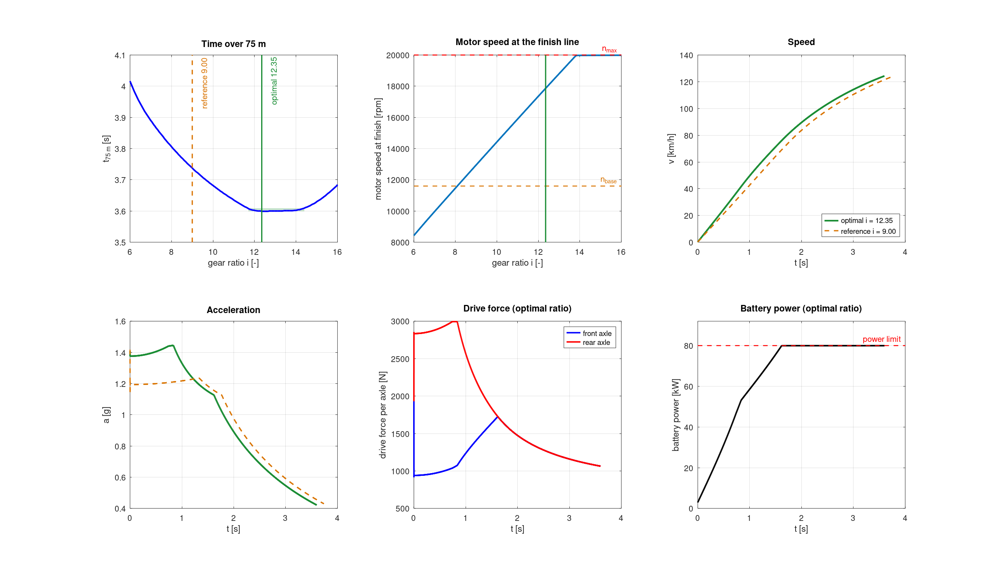
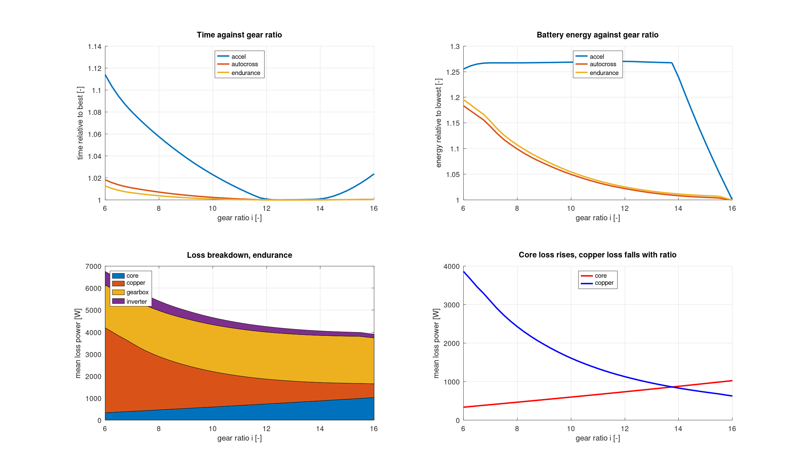
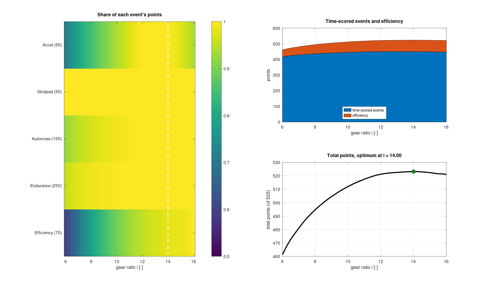

# Formula Student gear ratio study

A vehicle and drivetrain model in MATLAB/Simulink that answers one design question for a four-wheel-drive electric Formula Student car: **which gear ratio between the hub motors and the wheels scores the most points?**

I built it in 2026 as controls engineer at High-Speed Karlsruhe e.V. (Formula Student Electric, KIT). It started as a simulation of the 75 m acceleration event and grew into a study over all four dynamic events, with a loss model for the efficiency score.

> The parameters in this repository are representative Formula Student values and public motor datasheet figures, and the loss coefficients are illustrative. They are not the team's car data or measurements, so the numbers below are not the team's results. The team version uses measured motor, tyre and aero data.

## The question

A higher ratio gives more wheel torque, but the motor reaches its speed limit sooner, the rotor inertia costs more and core losses rise. A lower ratio needs more motor current for the same wheel force, so copper losses rise. The tyres cap what can be used at low speed, and the rules cap electrical power at 80 kW. The fastest ratio for a sprint is therefore not the best ratio for a 22 km endurance run scored partly on energy.

The planetary gearbox can only be built with certain tooth counts, so the useful result is not one number but the **band of ratios that lose almost nothing**.

## Three studies

| Script | Question | Model |
|---|---|---|
| `study_acceleration.m` | Which ratio is fastest over 75 m? | Time-domain simulation |
| `study_losses.m` | What does each ratio cost in time, energy and losses? | Quasi-steady-state lap simulation |
| `study_points.m` | Which ratio scores the most points over all events? | Both, with the FS 2026 scoring formulas |

Each script runs on its own, prints its result and saves a figure to `docs/`. No toolboxes are needed. They also run in GNU Octave 11.

## Model

| Part | How it is modelled |
|---|---|
| Motor | Fischer TI085 peak curve: constant torque to base speed, constant power to maximum speed, then zero |
| Power limit | Electrical: torque is reduced until mechanical power plus losses of all four motors stay within 80 kW |
| Losses | Copper `3·R(T)·I²` with temperature-dependent resistance, core loss rising with speed, inverter switching and conduction, constant gearbox efficiency, auxiliary load |
| Tyres | Simplified Magic Formula with load sensitivity, or constant friction |
| Load transfer | Axle loads from static distribution, downforce and longitudinal acceleration |
| Aero | Drag and downforce proportional to v², with a front/rear balance |
| Inertia | Wheels and rotors reflected as extra mass: `m_eff = m + (4·J_wheel + 4·J_rotor·i²) / r²` |
| Cornering | Single-track model: each axle's lateral grip against the mass it carries; the axle that saturates first sets the corner speed |
| Lap | Three passes: corner speed limit, forward acceleration, backward braking; the profile is the minimum |
| Scoring | Formula Student 2026 formulas for acceleration, skidpad, autocross, endurance and efficiency |

In the acceleration model each axle delivers the smaller of motor force and tyre limit at every time step:

```
F_axle = min( 2 · T(ω) · i · η / r ,  2 · Fx_max(Fz_axle / 2) )
a      = ( F_front + F_rear − F_drag − F_roll ) / m_eff
```

Load transfer depends on acceleration, and acceleration depends on the loads. The loop is broken by using the acceleration from the previous time step, which is what the Memory block does in the Simulink version.

## Results with the generic parameter set

### Acceleration



| | Gear ratio | Time over 75 m | Speed at finish | Motor speed at finish |
|---|---|---|---|---|
| Optimum | 12.35 | 3.599 s | 124 km/h | 17 900 rpm |
| Within 10 ms of the optimum | 11.70 to 14.40 | up to 3.609 s | | |
| Too short a ratio | 8.00 | 3.806 s | 123 km/h | 11 500 rpm |
| Too long a ratio | 16.00 | 3.684 s | 107 km/h | 20 000 rpm (limit) |

- **The optimum is flat.** Any ratio from 11.70 to 14.40 is within 10 ms.
- **Below the band the car is torque-limited.** At i = 8 the motors cannot deliver the force the tyres could transmit.
- **Above the band the motor runs out of speed.** From about i = 14 the motors reach 20 000 rpm before the finish line.
- **Two limits act in sequence.** The front axle is traction-limited for the first 1.6 s; after that the 80 kW limit sets the drive force until the finish. Peak acceleration is 1.45 g.

### Time, energy and losses



- **Sprint time is far more sensitive to the ratio than lap time.** A ratio of 6 costs 11 % over 75 m but under 2 % in autocross and endurance, where corners set the pace.
- **Energy falls as the ratio rises.** A higher ratio needs less motor current for the same wheel force, so copper loss falls faster than core loss rises. Over the endurance run the lowest ratio uses about 20 % more energy than the highest.
- **Copper and core loss cross near i = 14** in endurance. Below that, copper dominates the motor losses.

### Points over all events



| Event | Points at i = 14.00 | Ratio that is best for this event alone |
|---|---|---|
| Acceleration | 49.9 of 50 | 12.50 |
| Skidpad | 50.0 of 50 | any (grip-limited) |
| Autocross | 99.9 of 100 | 12.50 |
| Endurance | 249.9 of 250 | 12.50 |
| Efficiency | 73.4 of 75 | 16.00 |

- **The points-optimal ratio is 14.00**, higher than the fastest ratio of about 12.4, because the efficiency score rewards lower energy and the time-scored events lose almost nothing up to i = 14.
- **Ratios from 12.75 to 15.00 are within one point** of the best total.
- **A short ratio is expensive.** At i = 6 the car gives up about 60 of 525 points, most of them in efficiency and acceleration.

There is no competitor data in the model, so each event is scored against the best result inside the sweep. The points show what an off-optimal ratio loses, not a predicted competition score.

## Running it

```matlab
study_acceleration
study_losses
study_points
```

Simulink version of the baseline acceleration model:

```matlab
cd simulink
build_model      % creates accel_baseline.slx from script
sweep_simulink   % runs the sweep through the model
```

`build_model.m` creates the block diagram programmatically, so the model is reproducible from text and can be reviewed in a diff.

## Repository layout

```
study_acceleration.m       75 m sweep, tolerance band, plots
study_losses.m             time, energy and loss breakdown against ratio
study_points.m             points over all events, heatmap
src/params_generic.m       all parameters in one place
src/motor_torque.m         motor peak torque envelope
src/motor_losses.m         copper, core and inverter loss of one motor
src/build_torque_curve.m   envelope with the electrical power limit applied
src/drive_torque.m         lookup in that curve
src/mf_fx.m                simplified Magic Formula
src/tire_limit.m           peak tyre force, longitudinal and lateral
src/run_accel.m            time-domain 75 m run
src/corner_speed.m         single-track corner speed
src/make_track.m           event geometry
src/lap_sim.m              quasi-steady-state lap time and energy
src/loss_model.m           losses and battery power along a speed profile
src/fs_points.m            Formula Student 2026 scoring
simulink/                  scripted Simulink baseline model and sweep
```

## How the model developed

Each step was added because the previous version gave an answer that did not hold up:

1. **Rear-wheel drive, closed-form traction limit.** Enough to see the shape of the time-against-ratio curve.
2. **Magic Formula tyre and aero.** The traction limit now changes with speed and load.
3. **Four-wheel drive.** Separate axle loads and traction limits, wheel and rotor inertia, gearbox efficiency, power limit.
4. **RK4 integration** as a check on the Euler scheme, and a **Simulink model built from script** as a second implementation.
5. **Fine sweep and tolerance band**, to turn "the optimum" into a range the gearbox designers could pick tooth counts from.
6. **Loss model.** Copper, core, inverter and gearbox losses, battery power and energy, and the power limit applied electrically instead of mechanically.
7. **All four events.** Lap simulation, scoring formulas and the points heatmap.
8. **Single-track cornering model**, so corner speed depends on which axle runs out of grip.

## Limitations

- No wheel dynamics: the tyres sit at the slip ratio of peak force, as if traction control were ideal.
- Quasi-static load transfer, no suspension, no lateral load transfer, no combined slip in corners.
- Braking is fully regenerative with no limit from the motors or the battery, which flatters the energy figures.
- Gearbox efficiency is a constant 95 %; it is the largest single loss in endurance and deserves a load- and speed-dependent model.
- Winding temperature is a fixed input, not computed; a thermal model would set it per event.
- Autocross and endurance use a synthetic lap, not a surveyed track.
- The Simulink baseline uses constant tyre friction and has no losses or power limit.
- Nothing in this repository is validated against measured runs.

## Author

Shubham Pathak, M.Sc. student in Mechatronics and Information Technology at KIT.
